# AWS-CloudWatch-Monitoring
Created an AWS CloudWatch project to monitor EC2 instances, track CPU utilization, view logs, and configure monitoring alarms. Learned how to monitor AWS resources and identify performance issues using CloudWatch.

## 📌 Project Overview

This project demonstrates how to create an **Amazon CloudWatch Alarm** to monitor CPU utilization of an Amazon EC2 instance.

The CloudWatch alarm monitors the `CPUUtilization` metric. When the average CPU utilization exceeds **30%**, the alarm automatically changes its state from `OK` to `ALARM`.

## 🎯 Project Objectives

- Monitor EC2 instance CPU utilization.
- Configure CloudWatch metrics.
- Create a CloudWatch alarm.
- Set a CPU utilization threshold of 30%.
- Detect high CPU usage.
- Understand CloudWatch alarm states.

## 🛠️ AWS Services Used

| AWS Service | Purpose |
|---|---|
| Amazon EC2 | Virtual server |
| Amazon CloudWatch | CPU utilization monitoring |
| CloudWatch Alarm | Detect high CPU usage |
| AWS CLI | Configure AWS resources |

## 🏗️ Project Architecture

```text
       ┌──────────────────┐
       │    Amazon EC2    │
       │     MyServer     │
       └────────┬─────────┘
                │
                │ CPU Utilization
                ▼
       ┌──────────────────┐
       │ Amazon CloudWatch│
       │  CPUUtilization  │
       └────────┬─────────┘
                │
                │ CPU > 30%
                ▼
       ┌──────────────────┐
       │ CloudWatch Alarm │
       │   ALARM State    │
       └──────────────────┘
```

## 🚀 Implementation Steps

## Step 1: Open Amazon CloudWatch

1. Log in to the **AWS Management Console**.
2. Search for **CloudWatch** in the search bar.
3. Click **CloudWatch – Monitor Resources and Applications**.
4. Verify that the AWS Region is set to **Europe (Stockholm)**.
5. Open the CloudWatch service.

**Description:**

I accessed Amazon CloudWatch through the AWS Management Console to start configuring an alarm for monitoring EC2 CPU utilization.
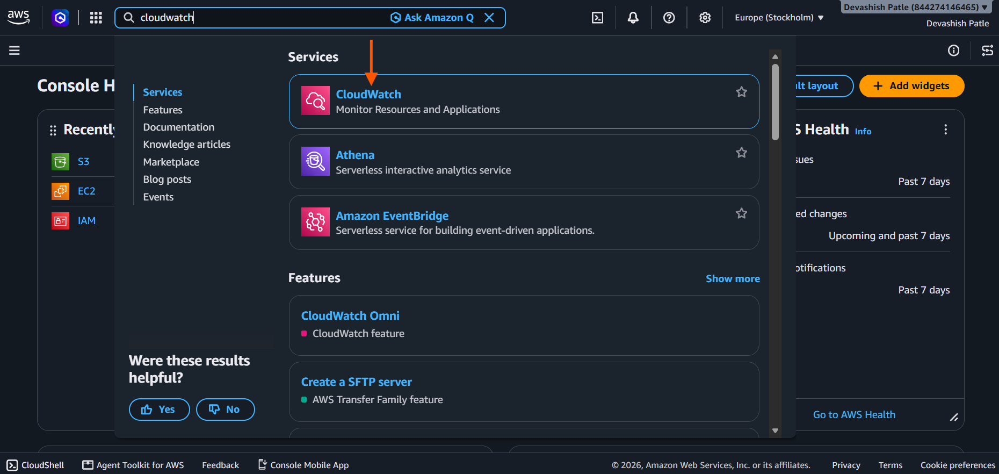

---

## Step 2: Open CloudWatch Alarms

1. In the left-side menu of the CloudWatch Dashboard, click **Alarms**.
2. The CloudWatch Alarms section will open.
3. From this section, you can create and manage alarms for your EC2 instance.
4. Click **Create alarm** to start configuring a CPU utilization alarm.

**Description:**

I navigated to the Alarms section in Amazon CloudWatch to create an alarm for monitoring my EC2 instance's CPU utilization.
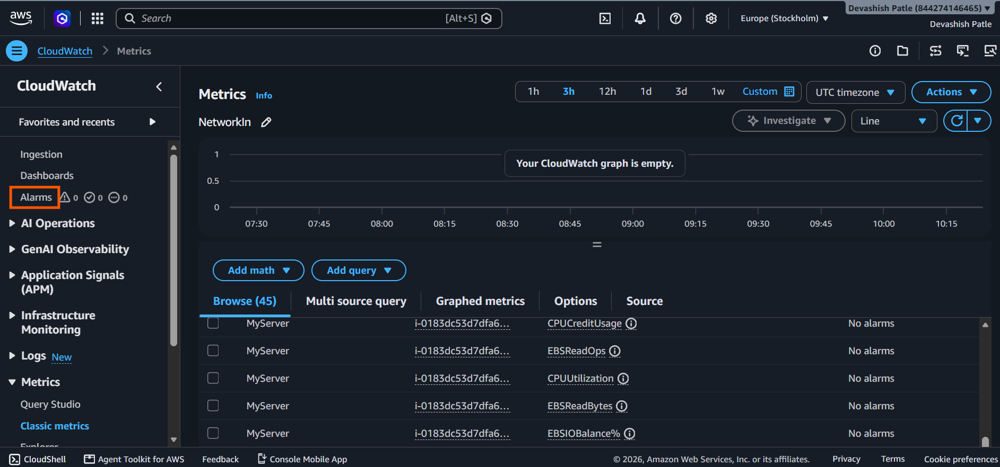

---

## Step 2: Click on Create Alarm

1. In the left-side menu of the CloudWatch Dashboard, click **Alarms**.
2. The CloudWatch Alarms page will open.
3. Click the **Create alarm** button in the top-right corner.
4. The alarm creation page will open.

**Description:**

I opened the CloudWatch Alarms section and clicked the **Create alarm** button to start creating an alarm for monitoring EC2 CPU utilization.


---

## Step 3: Create CloudWatch Alarm

1. On the CloudWatch Alarms page, locate the **Create alarm** button.
2. Click **Create alarm** in the top-right corner.
3. This will open the alarm configuration page.

**Description:**

I clicked the **Create alarm** button to start creating a new CloudWatch alarm for monitoring EC2 CPU utilization.
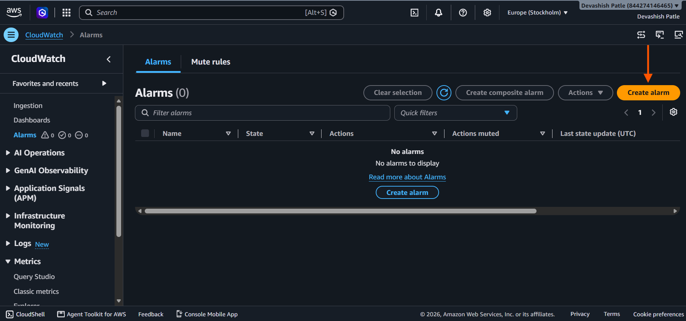

---

## Step 4: Specify Metric and Conditions

1. On the **Create alarm** page, select **Metrics** under Data source.
2. Under Type, keep **Classic** selected.
3. In the Metric section, click **Select metric**.
4. This will open the metric selection page.
5. Select the EC2 `CPUUtilization` metric for your instance.

**Description:**

I selected Metrics as the data source and Classic as the metric type. Then I clicked **Select metric** to choose the EC2 CPU utilization metric for creating the CloudWatch alarm.
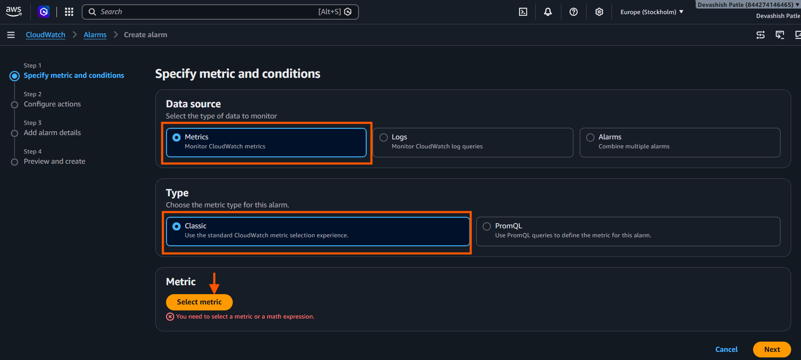

---

## Step 5: Select EC2 Metrics

1. On the **Select metric** page, locate the **EC2** category.
2. Click **EC2** to view the available EC2 metrics.
3. Select the **Per-Instance Metrics** option on the next page.
4. Find your EC2 instance named **MyServer**.

**Description:**

I selected the EC2 category from the CloudWatch metric selection page to access the available metrics for my EC2 instance.
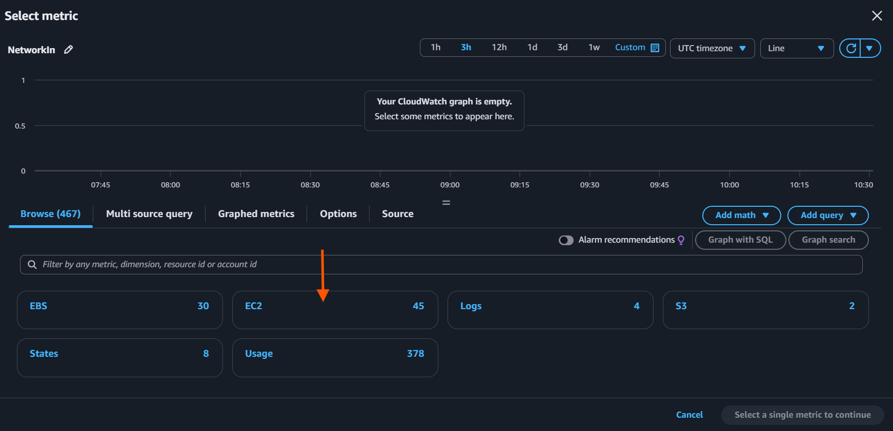

---

## Step 6: Select Per-Instance Metrics

1. On the EC2 metrics page, click **Per-Instance Metrics**.
2. The list of available EC2 instance metrics will appear.
3. Locate your instance named **MyServer**.
4. Select the required CPU utilization metric in the next step.

**Description:**

I selected **Per-Instance Metrics** to view the monitoring metrics associated with my EC2 instance.
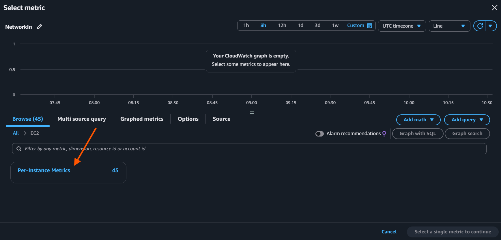

---

## Step 7: Select CPUUtilization Metric

1. Locate your EC2 instance named **MyServer**.
2. Find the `CPUUtilization` metric in the metrics list.
3. Select the checkbox next to **CPUUtilization**.
4. Click the **Select metric** button at the bottom-right corner.
5. The selected metric will be added to the alarm configuration.

**Description:**

I selected the `CPUUtilization` metric for my EC2 instance `MyServer` to monitor CPU usage and configure an alarm when CPU utilization exceeds 30%.
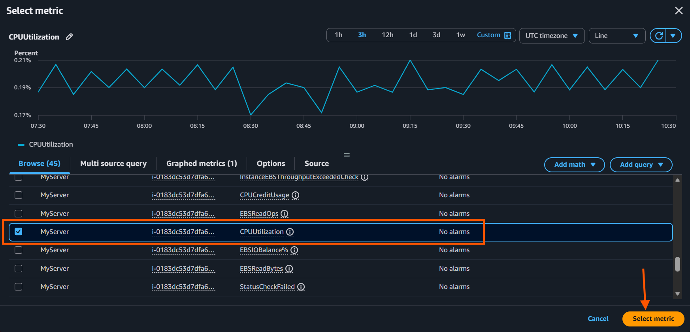

---

## Step 8: Configure CPU Utilization Threshold

1. Under the **Statistic** option, select **Average**.
2. Set the monitoring period to **5 minutes**.
3. Under the alarm condition, select **Greater**.
4. Enter **30** as the threshold value.
5. This configures the alarm to trigger when average CPU utilization exceeds 30%.
6. Click **Next** to continue.

**Description:**

I configured the CloudWatch alarm condition to monitor average EC2 CPU utilization over a 5-minute period. The alarm will trigger when CPU utilization exceeds 30%.
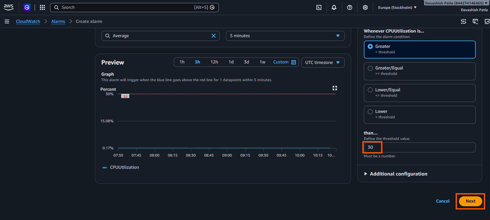

---

## Step 9: Configure Alarm Notifications

1. Under **Alarm state trigger**, select **In alarm**.
2. Under SNS topic, select **Create new topic**.
3. Enter the topic name: `Default_CloudWatch_Alarms_Topic`.
4. Enter your email address to receive alarm notifications.
5. Click **Create topic** to configure the notification.

**Description:**

I configured Amazon CloudWatch notifications by selecting the **In alarm** state and creating a new SNS topic. I added my email address to receive notifications when EC2 CPU utilization exceeds 30%.
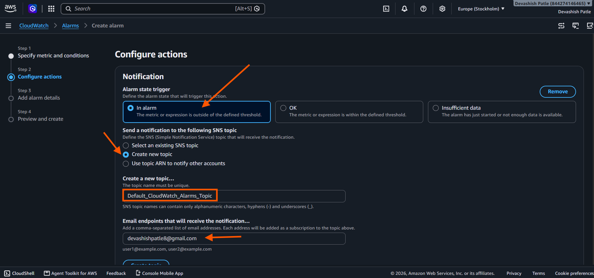

---

## Step 10: Configure Alarm Actions

1. Scroll down to the additional alarm actions section.
2. Review the available EC2 and Auto Scaling actions.
3. Click **Next** to proceed to the alarm details.

**Description:**

After configuring the SNS notification topic, I reviewed the additional alarm action options and clicked **Next** to continue with the CloudWatch alarm configuration.
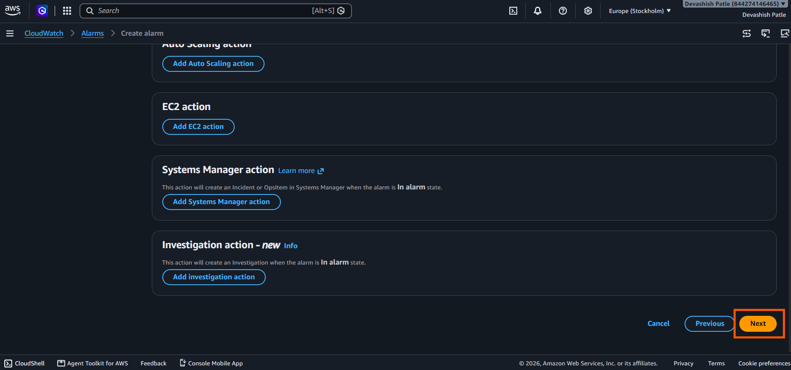

---

## Step 11: Add Alarm Details

1. Enter the alarm name: `Hit-Me`.
2. In the **Alarm description** field, enter: `Triggers when EC2 CPU utilization exceeds 30%.`
3. Review the alarm details.
4. Leave the optional Tags section unchanged if not required.
5. Continue to the next step.

**Description:**

I entered the CloudWatch alarm name and description to identify the alarm and specify that it monitors EC2 CPU utilization above 30%.
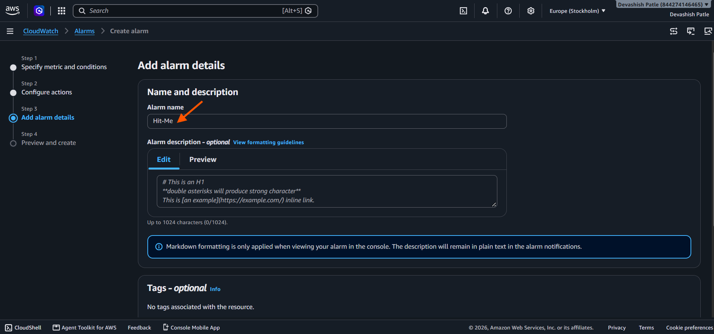

---

## Step 12: Preview and Review Alarm Configuration

1. Review the selected metric namespace: **AWS/EC2**.
2. Verify the metric name is **CPUUtilization**.
3. Check that the EC2 instance name is **MyServer**.
4. Verify the statistic is **Average**.
5. Confirm the monitoring period is **5 minutes**.
6. Review the alarm configuration before creating it.

**Description:**

I reviewed the CloudWatch alarm configuration, including the EC2 instance, CPUUtilization metric, average statistic, and 5-minute monitoring period to ensure the settings were correct.
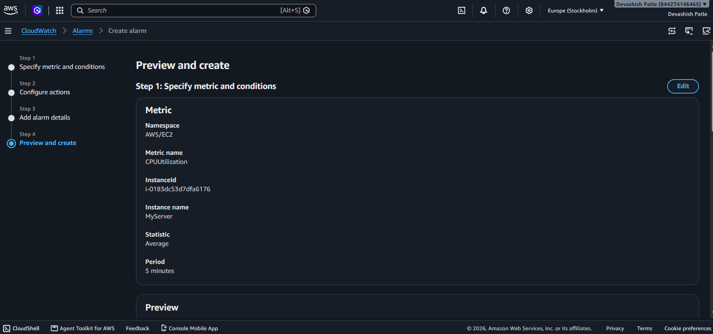

---

## Step 13: Review and Create CloudWatch Alarm

1. Review the notification settings under **Actions**.
2. Verify the SNS topic is `Default_CloudWatch_Alarms_Topic`.
3. Review the alarm details.
4. Click **Create alarm** to create the CloudWatch alarm.

**Description:**

I reviewed the alarm configuration, including the CPU utilization metric, notification topic, and alarm details. Finally, I clicked **Create alarm** to create the EC2 CPU utilization alarm.
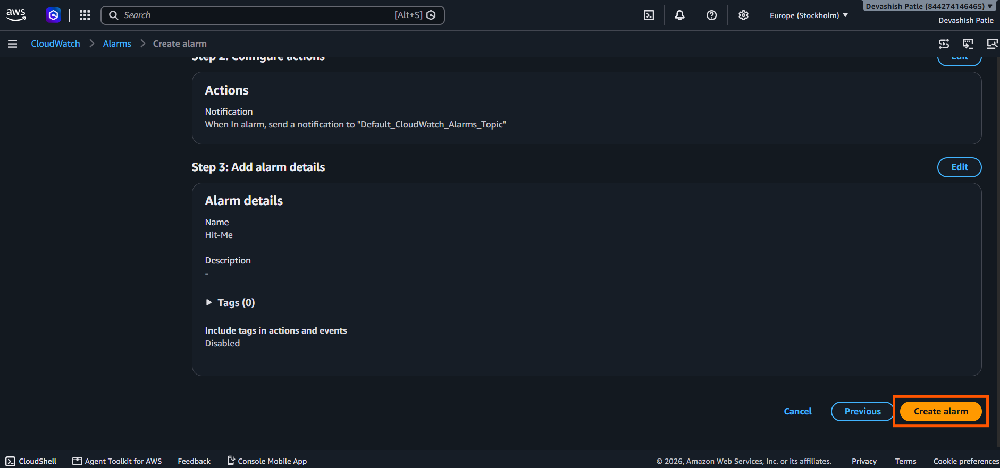

---

## Step 14: Verify Alarm Creation

1. After clicking **Create alarm**, return to the CloudWatch Alarms page.
2. A success message confirms that the alarm was created successfully.
3. Verify that the new alarm named **Hit-Me** appears in the alarms list.
4. Check the current alarm state. It may show **Insufficient data** while CloudWatch collects metric data.

**Description:**

I successfully created the CloudWatch alarm for my EC2 instance. The alarm is now listed in the CloudWatch Alarms dashboard and is ready to monitor CPU utilization against the configured 30% threshold.
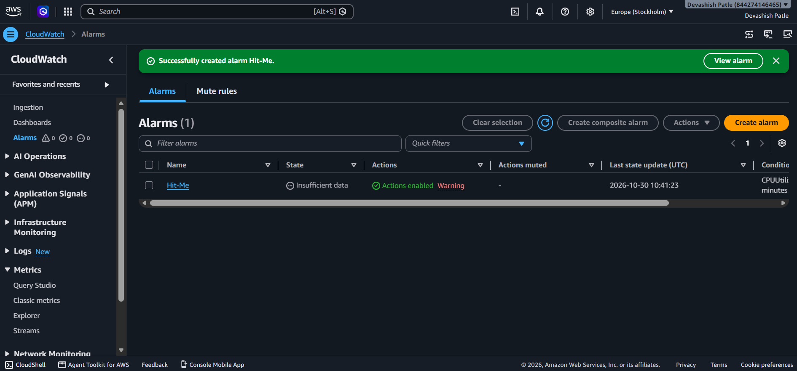

---

## Step 15: Verify CloudWatch Alarm Status

1. Open the CloudWatch **Overview** dashboard.
2. Navigate to the **Recent alarms** section.
3. Locate the alarm named **Hit-Me**.
4. Verify that the alarm state is **OK** (green).
5. Check the CPUUtilization graph and confirm that CPU usage is below the 30% threshold.

**Description:**

I verified the CloudWatch alarm on the Overview dashboard. The alarm successfully entered the **OK** state, indicating that the EC2 instance CPU utilization is currently below the configured 30% threshold.
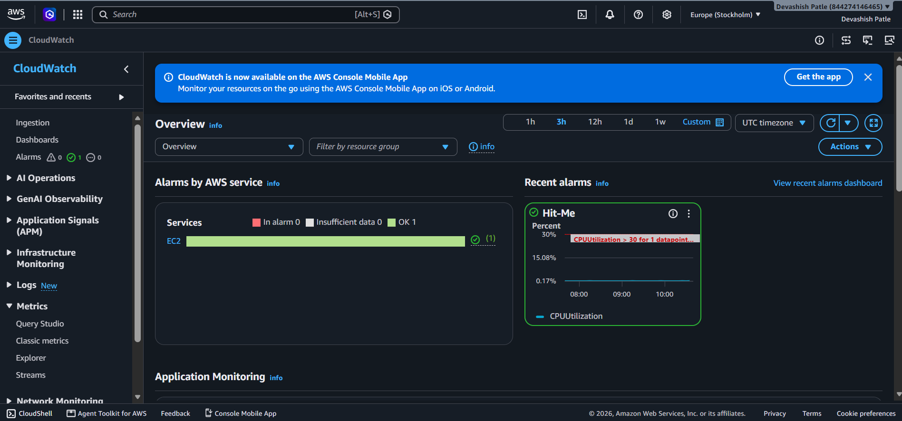

---


